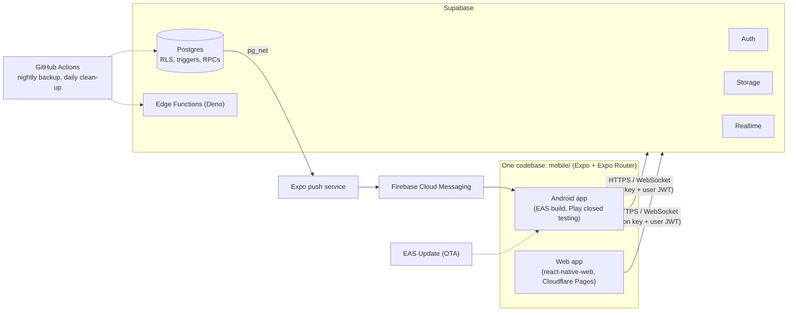

<div align="center">

# pincode · your neighborhood

**A hyperlocal community app: ask, alert and meet the people around you, sorted by distance.**

[](https://github.com/danishsultan007/pincode/actions/workflows/backup.yml)
[](https://github.com/danishsultan007/pincode/actions/workflows/cleanup-attachments.yml)


-orange)


[Live web app](https://pincode-a54.pages.dev) · [Architecture](ARCHITECTURE.md) · [Setup guide](SETUP.md) · [Release process](RELEASING.md) · [Changelog](CHANGELOG.md)

</div>

---

## Contents

- [Overview](#overview)
- [Features](#features)
- [Architecture](#architecture)
- [Tech stack](#tech-stack)
- [Repository layout](#repository-layout)
- [Getting started](#getting-started)
- [Configuration](#configuration)
- [Testing](#testing)
- [Deployment and releases](#deployment-and-releases)
- [Security and privacy](#security-and-privacy)
- [Documentation](#documentation)
- [Legacy prototype and historical documents](#legacy-prototype-and-historical-documents)
- [Contributing](#contributing)
- [Support](#support)
- [License](#license)

## Overview

**pincode · your neighborhood** is a hyperlocal community app. It started in Mahadevapura, Bengaluru, and the nearby areas of Hoodi, Whitefield, KR Puram and Bellandur. People see posts from around them, sorted by distance, as a list or on a map.

One TypeScript codebase in [`mobile/`](mobile) produces:

| Target | Delivery | Status |
|---|---|---|
| **Android app** | EAS builds, Google Play closed testing, over-the-air (OTA) updates | Live in closed testing |
| **Web app** | `react-native-web`, hosted on Cloudflare Pages | Live |
| **iOS app** | Configured (`com.pincode.app`) | Never built or shipped |

The backend is a [Supabase](https://supabase.com) project: Postgres with Row Level Security, Auth, Storage, Realtime and Edge Functions.

## Features

- **Posts**: Ask (looking for / offering), Alert and Event posts, with an optional photo, tag, map pin and a phone number revealed only on tap.
- **Answers and comments**: threaded comments, and the author can mark an answer as solved.
- **Votes and reactions**: helpful votes, one emoji reaction per person, and "still happening" / "resolved" confirmations on alerts.
- **Communities**: join, leave, community feeds, owners and moderators.
- **Direct messages**: message requests (accept, decline or block), photos, replies, delete for me or for everyone, emoji reactions, and sent / delivered / read ticks with a read-receipts privacy switch.
- **Notifications**: an in-app list, live toasts, and push notifications on Android.
- **Reputation and badges**: points awarded by database triggers, and nine badges.
- **Moderation and admin**: a word filter, user reports, strikes and suspensions, and an admin area.
- **Accounts and consent**: a terms-acceptance gate, a feedback form, and in-app account deletion.

See [ARCHITECTURE.md](ARCHITECTURE.md#1-what-the-app-is) for the verified feature list.

## Architecture



- **Security lives in the database.** The client holds only the public anon key. Every table has Row Level Security and explicit column grants; sensitive logic runs in `SECURITY DEFINER` functions and triggers.
- **Realtime** delivers new messages, notifications and delivery receipts while the app is open. Pushes reach a closed Android app through Expo's push service and Firebase Cloud Messaging.
- **Two Supabase projects** (development and production) keep experiments away from real data.

The full walkthrough, including every service the product depends on, is in [ARCHITECTURE.md](ARCHITECTURE.md).

## Tech stack

| Area | Technology |
|---|---|
| App framework | Expo SDK 57, React Native 0.86, React 19, TypeScript |
| Navigation | Expo Router (file-based routes, route guards) |
| Web | `react-native-web`; Leaflet with OpenStreetMap tiles on web, `react-native-maps` on Android |
| Data fetching | TanStack Query 5, `@supabase/supabase-js` 2 |
| Backend | Supabase: Postgres (RLS, triggers, RPCs), Auth, Storage, Realtime, Edge Functions (Deno) |
| Push | Expo push service, Firebase Cloud Messaging |
| Builds and updates | EAS Build, EAS Update (OTA), Google Play closed testing |
| Web hosting | Cloudflare Pages |
| Automation | GitHub Actions (nightly encrypted database backup, daily chat-photo clean-up) |
| Monitoring | Sentry (optional, enabled only when a DSN is configured) |

## Repository layout

```text
.
├── mobile/                  Expo app: Android and web from one codebase
│   ├── src/app/             Screens and routes (Expo Router)
│   ├── src/components/      UI components
│   ├── src/api/, hooks/     Supabase calls and TanStack Query hooks
│   └── app.config.ts        App identity, version, native config
├── supabase/
│   ├── migrations/          Database schema, RLS and functions (apply in order)
│   ├── functions/           Edge Functions (sign-in, password reset, delete account, clean-up)
│   ├── tests/               SQL regression tests
│   ├── seed.sql             Development-only sample data
│   └── PATCH_*.sql, RUN_ALL_*.sql   Historical one-off patches and combined SQL for the SQL editor
│                            (the migrations folder is the source of truth)
├── scripts/                 release-check.ps1, publish-ota.ps1 (release helpers, PowerShell)
├── .github/workflows/       Nightly backup and chat-photo clean-up
└── *.md                     Documentation (see below)
```

The repository root also contains an older static prototype; see [Legacy prototype](#legacy-prototype-and-historical-documents).

## Getting started

### Prerequisites

- Node.js 22 or newer (Node 24 recommended) and npm
- A Supabase project with the migrations in [`supabase/migrations`](supabase/migrations) applied (see [`supabase/README.md`](supabase/README.md))
- For device builds and OTA updates: an [Expo](https://expo.dev) account with EAS access

On Windows PowerShell, use `npm.cmd` and `npx.cmd` if script execution is restricted.

### Run locally

```bash
cd mobile
npm install
cp .env.example .env     # fill in EXPO_PUBLIC_SUPABASE_URL and EXPO_PUBLIC_SUPABASE_ANON_KEY
npm run start            # press "w" for the web app
```

For Android, install a development build first (`eas build --profile development`); the app uses `expo-dev-client`, so Expo Go is not used.

Until `.env` is filled in, the app shows a "Setup needed" screen instead of the normal navigation.

Step-by-step setup, including creating the Supabase project and Google sign-in, is in [SETUP.md](SETUP.md). Day-to-day commands for the `mobile` app are in [mobile/README.md](mobile/README.md).

## Configuration

Configuration is read from `mobile/.env` (copy [`mobile/.env.example`](mobile/.env.example)). Never commit real values.

| Variable | Required | Purpose |
|---|---|---|
| `EXPO_PUBLIC_SUPABASE_URL` | Yes | Supabase project URL |
| `EXPO_PUBLIC_SUPABASE_ANON_KEY` | Yes | Public anon key (access is enforced by Row Level Security) |
| `EXPO_PUBLIC_WEB_URL` | No | Public web address used in share links |
| `EXPO_PUBLIC_APP_ENV` | No | `development`, `preview` or `production` (tags Sentry events) |
| `EXPO_PUBLIC_EAS_PROJECT_ID` | No | Overrides the EAS project id set in `app.config.ts` |
| `EXPO_PUBLIC_GOOGLE_WEB_CLIENT_ID`, `EXPO_PUBLIC_GOOGLE_ANDROID_CLIENT_ID`, `EXPO_PUBLIC_GOOGLE_IOS_CLIENT_ID` | Reserved | For a future native Google sign-in (today Google sign-in uses the browser flow through Supabase) |
| `GOOGLE_MAPS_ANDROID_API_KEY` | Android builds | Build-time key for Google Maps on Android |
| `EXPO_PUBLIC_SENTRY_DSN` | No | Crash reporting; leave empty to disable |

Build-time secrets are kept in EAS environment variables. Secrets used by GitHub Actions workflows are stored as repository secrets and named in each workflow file. Supabase Edge Function secrets are set in Supabase.

## Testing

- **Type check:** `cd mobile && npm run typecheck`
- **Database regression tests:** SQL files in [`supabase/tests`](supabase/tests) check access rules, reactions, replies, read receipts, message deletion and photo handling. Each runs inside a transaction and ends with an intentional error such as `ALL ... PASSED (rolled back)`, so nothing is left behind:

  ```bash
  npx supabase db query --linked --file supabase/tests/<name>.sql
  ```

  The exception is `smoke.sql`: it needs `seed.sql`, is for the development database only, and is run in the Supabase SQL editor.

There are currently no automated unit or UI tests, and no CI runs on pull requests. Releases are gated by `scripts/release-check.ps1` (see below).

## Deployment and releases

| What changed | How it ships |
|---|---|
| **Web** | Push `main` to the `production` branch; Cloudflare Pages builds `mobile` with `npm run export:web:cf` |
| **Database or Edge Functions** | Back up, apply migrations to development, then production, then re-run the SQL tests |
| **JavaScript-only app changes** | OTA update with `scripts/publish-ota.ps1` after `scripts/release-check.ps1` passes |
| **Native changes** (new native modules, permissions, version bump) | EAS build (`development`, `preview` APK or `production` AAB) and a Google Play release |

Versions follow `vX.Y.Z`; OTA updates are tagged `vX.Y.Z+ota.N` and database-only releases `db-YYYYMMDD`. The release order, rollback commands and the database "expand then contract" rules are in [RELEASING.md](RELEASING.md); hosting details are in [DEPLOY.md](DEPLOY.md).

## Security and privacy

- Row Level Security and column-level grants on every table; the client only ever holds the public anon key, and the service-role key exists only as an Edge Function secret.
- Sign-in with a username or phone and password reset go through rate-limited Edge Functions that do not reveal whether an account exists.
- Private chat photos are stored in a private bucket, shown through short-lived signed links, and removed automatically after 90 days.
- Direct messages can be deleted for the sender or for both people; read receipts can be turned off in Settings.
- Content is checked by a word filter, and users can report content and block people; moderation actions are logged.
- Security headers for the web app are defined in [`mobile/public/_headers`](mobile/public/_headers) (the content security policy is in report-only mode for now).
- Production data is backed up nightly with encryption (see [`.github/workflows/backup.yml`](.github/workflows/backup.yml)).

**Reporting a vulnerability.** Please do not open a public issue. Contact the maintainer privately through the repository owner's GitHub profile and include steps to reproduce.

## Documentation

| Document | Purpose |
|---|---|
| [ARCHITECTURE.md](ARCHITECTURE.md) | Start here: product, stack, database, every service, key flows |
| [SETUP.md](SETUP.md) | One-time setup: Supabase, environment, sign-in |
| [DEPLOY.md](DEPLOY.md) | Hosting and deployment |
| [RELEASING.md](RELEASING.md) | Release types, order, rollbacks, Play closed testing |
| [CHANGELOG.md](CHANGELOG.md) | What changed in each release |
| [mobile/README.md](mobile/README.md) | Working in the app (scripts, structure) |
| [supabase/README.md](supabase/README.md) | Database, functions and tests |

## Legacy prototype and historical documents

The files `index.html`, `app.js`, `store.js`, `geo.js`, `pincodes.js`, `styles.css` and `serve.ps1` at the repository root are the original static prototype, then called "Mohalla". It stored data in the browser and is **not used by the current app**; it is kept for history. (`run.ps1` is current: it is a local development web server.)

These documents record earlier planning and may be out of date; prefer [ARCHITECTURE.md](ARCHITECTURE.md):

- Prototype: `PLAN.md`, `CHANGES-v1.2.md`, `IMPL-v1.2.md`
- Early design specifications: `MOBILE-PLAN.md`, `DESIGN-OVERHAUL.md`, `UI-REDESIGN-PLAN.md`

## Contributing

This is a proprietary project and is not open to unsolicited pull requests. For team members:

1. Branch from `main`.
2. Run `npm run typecheck` in `mobile/` and `scripts/release-check.ps1` before releasing.
3. Add user-visible and internal changes to the **Unreleased** section of [CHANGELOG.md](CHANGELOG.md).
4. Follow the release order in [RELEASING.md](RELEASING.md): database first, then app.

## Support

Testers can use **Settings → Send feedback** in the app. Anything security-related should follow the vulnerability-reporting note under [Security and privacy](#security-and-privacy).

## License

Copyright © 2026 pincode. All rights reserved.

This repository is proprietary. No licence to use, copy, modify or distribute the source code or assets is granted without prior written permission.
